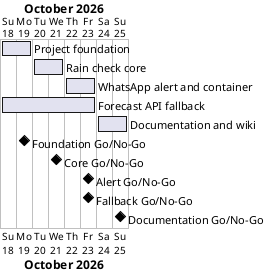

# Project Plan: Rain Alert

## Metadata
| Key | Value |
| --- | --- |
| ID | PP-001 |
| CrossReference | [BC-001], [SA-001], [MIL-001], [MIL-002], [MIL-003], [MIL-004], [MIL-005] |
| Language | en |
| Domain | it |

## Version History
| Date | Status | Author | Reviewer | Change | Commit |
| --- | --- | --- | --- | --- | --- |
| 2026-10-18 | Deprecated | Jens Tirsvad Nielsen | AI as stand-in for S01 | Initial version | [728ff3e] |
| 2026-10-18 | Accepted | Jens Tirsvad Nielsen | AI as stand-in for S01 | Added gateway MIL-005 (forecast API fallback) before MIL-004 after the live run showed HTTP 401 on One Call 4.0 | pending |

---

## Purpose

Schedules the five gateways that deliver Rain Alert within the Business Case window of 2026-10-18 to 2026-10-25 ([BC-001]). Each gateway is one milestone document, one Milestone on the git host and one pull request from its own branch.

## Planning Assumptions

- Week 1 starts 2026-10-18; the plan ends by 2026-10-25, per the Business Case constraint.
- Phase length: two days per gateway. S01 is the only owner and reviewer ([SA-001]); the AI acts as stand-in author and reviewer in autonomous mode.
- The baseline (Business Case, Stakeholder Analysis, Project Plan, governance, dictionary, ADR-0001, milestones) is accepted when the user accepts this plan in chat; MIL-001 starts after that.
- Branch per step: `plan-baseline`, `mil-001-project-foundation`, `mil-002-rain-check-core`, `mil-003-whatsapp-alert-and-container`, `mil-004-documentation-and-wiki`.

## Gateway Schedule

| Gateway | Document | Window | Decision date | Owner | Stories | Main deliverable | Milestone |
| --- | --- | --- | --- | --- | --- | --- | --- |
| Project foundation | [MIL-001] | 2026-10-18 to 2026-10-19 | 2026-10-19 | S01 | none | Configuration, skeleton, `config.env.example`, README, quality workflow, repository description and topics | |
| Rain check core | [MIL-002] | 2026-10-20 to 2026-10-21 | 2026-10-21 | S01 | none | Forecast model, rain decision, settings, One Call 4.0 client, tests | |
| WhatsApp alert and container | [MIL-003] | 2026-10-22 to 2026-10-23 | 2026-10-23 | S01 | none | Twilio WhatsApp notifier, scheduler, entry point, Dockerfile, Compose file, tests | |
| Forecast API fallback | [MIL-005] | 2026-10-18 to 2026-10-23 | 2026-10-23 | S01 | none | The free 2.5 forecast as a second, selectable forecast source | |
| Documentation and wiki | [MIL-004] | 2026-10-24 to 2026-10-25 | 2026-10-25 | S01 | none | Screenshots, README, wiki in three languages, wiki workflow | |



## Scope Coverage

| Business Case scope item | Gateway |
| --- | --- |
| Rain check: forecast model, decision, port, One Call 4.0 client | MIL-002 |
| WhatsApp notifier, dry run, scheduler, entry point | MIL-003 |
| Docker image and Compose file for Docker Desktop | MIL-003 |
| Second forecast source (free 2.5 forecast) chosen with `FORECAST_API` | MIL-005 |
| Configuration from `config.env`, `config.env.example` | MIL-001 (example, location), MIL-002 (loader) |
| Project configuration, folder structure, `constants.py`, `Doxyfile` | MIL-001 |
| pytest tests | MIL-001 (set-up), MIL-002 and MIL-003 (tests) |
| README with run and test instructions | MIL-001 (first version), MIL-004 (finished) |
| Screenshots, wiki in three languages | MIL-004 |
| Repository description and topics | MIL-001 |
| CI workflows from `TirSystem/github-action` | MIL-001 (quality), MIL-004 (wiki) |

## Dependencies

```
MIL-001 → MIL-002 → MIL-003 → MIL-005 → MIL-004
```

A No-Go on a gateway stops the chain: later windows move by the days needed to fix it, and the Business Case window is renegotiated with S01 if it runs past 2026-10-25.

## Plan Risks

| Risk | Impact | Mitigation |
| --- | --- | --- |
| The git host API or token fails when setting description and topics | MIL-001 cannot close criterion 6 | The tool stops and reports; S01 sets them by hand in the web UI |
| A required CI check on the host fails for a reason outside the project | A pull request cannot merge | Stop after three attempts on the same cause and report, as AGENTS.md requires |
| The OpenWeather key has no One Call 4.0 subscription, or Twilio values are missing from `config.env` | The live dry run or live send in MIL-003 cannot succeed | Everything else is tested with fakes; the run stops and reports which key or subscription is missing |
| Docker Desktop is not reachable from the build session | The image is not built here | Compose file validated by reading and `docker compose config` if available; S01 builds and reports |
| Screenshots need a desktop session | MIL-004 delay | Capture the terminal dry run and Docker Desktop on S01's own Windows desktop, masking secrets |

## Open Issues

- The repository URL in the request (`Tirsvad-Udemy-100_days_of_code`) differs from `origin` (`Tirsvad-Udemy-100-days-of-code/035-rain-alert`); the plan uses `origin`.
- The request's course text names Twilio SMS, PythonAnywhere and GitHub Actions; S01's changes (WhatsApp, Docker container, `config.env`) replace them, and the course alternatives are out of scope ([BC-001]).
- The reference script in S01's earlier repository used pywhatkit (WhatsApp Web in a browser) and the 2.5 forecast; a container has no browser, so this project sends through the Twilio WhatsApp sandbox and uses One Call 4.0.
- The first live run (2026-10-18) showed that the OpenWeather key has no One Call by Call subscription (HTTP 401 on One Call 4.0 and 3.0; the free 2.5 forecast answers). S01 chose to add the 2.5 forecast as a second source ([MIL-005]). [BC-001] objective O1 names One Call 4.0 and stays as accepted: One Call 4.0 remains the default, the 2.5 forecast is the fallback, and this note records the difference.
- Twilio account SID, auth token and sandbox number are not yet in `config.env`; S01 adds them before the first live send.
- Bahasa Malaysia text cannot be checked by S01 or the AI as a reader of the language; it stays flagged as unchecked in the wiki.

---

[BC-001]: ./business-case.md
[SA-001]: ./stakeholder-analysis.md
[MIL-001]: ./milestones/mil-001-project-foundation.md
[MIL-002]: ./milestones/mil-002-rain-check-core.md
[MIL-003]: ./milestones/mil-003-whatsapp-alert-and-container.md
[MIL-004]: ./milestones/mil-004-documentation-and-wiki.md
[MIL-005]: ./milestones/mil-005-forecast-api-fallback.md
[728ff3e]: https://git.tirsystem.com/Tirsvad-Udemy-100-days-of-code/035-rain-alert/commit/728ff3e9e195f722540d4959f4f0035b7af37c36
